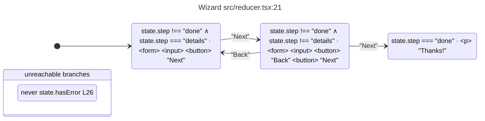

# Symbolic tree

Reads a React project with the TypeScript 7 checker and prints, for each component, a Mermaid flowchart of everything it can render and a Mermaid state diagram of its states and transitions. It never runs the code.

## Run

```sh
pnpm analyze tests/fixtures/symbolic-tree/tsconfig.json              # every component
pnpm analyze tests/fixtures/symbolic-tree/tsconfig.json -c Wizard    # one component
pnpm analyze path/to/app/tsconfig.json -f features/ --json
```

Run these from `packages/bippy-analyzer`.

The output is two Mermaid diagrams per component, which GitHub and most markdown viewers render when they are pasted into `mermaid` code blocks.

The first is a `flowchart` of the render tree: every element the component can render, with a diamond at each branch and its `✓` and `✗` arms below it, a double-bordered box for each list, and a dashed pill for what each handler and effect does to state, like `onClick ⇒ step = "details"`. An expression the analyzer couldn't evaluate is shown as written, marked `⚠`.

The second is a `stateDiagram-v2`. Each state is labelled with the conditions that select it and what it renders, each transition with the button text, the handler or the effect that causes it, and `[*]` points at the state the component first renders when its initial state values decide that. A condition shows only what decides the state, so the branch `step !== 0 ∧ step !== 1 ∧ step === 2` reads `step === 2`. A handler that leads from every state in a region to every other is drawn once, as a `from any state` box with an arrow to each state. A component with several independent regions draws them as concurrent regions, and a region with more states than are drawn ends in a `more` state that the hidden transitions lead to. Unreachable branches, warnings and bailouts are listed in their own boxes. The counts go to stderr. With `--json`, the full analysis is printed instead. Run `--help` for all options.

| Option                       | Effect                                                 |
| ---------------------------- | ------------------------------------------------------ |
| `-c, --component <names...>` | Show only these components                             |
| `-f, --file <filter>`        | Show only files whose path contains this text          |
| `-d, --depth <n>`            | Cut the render tree off at this depth (default: 12)    |
| `-s, --states <n>`           | Draw at most this many states per region (default: 32) |
| `--json`                     | Print the analyses as JSON instead                     |

Labels use a few symbols:

- `∧` joins the conditions a state needs, `∉ {…}` a place that is none of these values
- `◆` a branch another region decides, `↻` a list
- `⚠` an expression the analyzer couldn't evaluate, shown as written
- `· ∅` the state renders nothing

## What it does

The pipeline runs the React Compiler's own front end, then our passes. Read `src/core` in this order:

| File                        | Stage                                                                            |
| --------------------------- | -------------------------------------------------------------------------------- |
| `analyze-project.ts`        | Opens the TS project, compiles each file, runs each component, then lists states |
| `compile.ts`                | Runs the React Compiler on a file and keeps each function's HIR                  |
| `analyze-component.ts`      | Runs our passes on one component's HIR                                           |
| `type-provider.ts`          | Types the compiler's HIR from the TS checker                                     |
| `interpret.ts`              | Runs the HIR symbolically: the render tree, with every branch kept               |
| `control-flow-walker.ts`    | Walks the HIR blocks: branches, switches, loops, phis and catch handlers         |
| `walk-state.ts`             | The guards and async flag a walk carries                                         |
| `binding-table.ts`          | The interpreter's bindings, one per declaration, and each place's domain         |
| `function-registry.ts`      | Functions values refer to, the file each came from, and closure captures         |
| `external-sources.ts`       | Hooks, contexts and stores: values that change from outside                      |
| `effect-collector.ts`       | The updates and mutations one handler or effect makes                            |
| `build-jsx.ts`              | The element each JSX tag renders                                                 |
| `diagnostics.ts`            | Bailouts and warnings, each reported once                                        |
| `symbolic-values.ts`        | Builds and folds the values the interpreter produces                             |
| `control-flow.ts`           | Branch outcomes and the conditionals they merge into                             |
| `source-file-resolver.ts`   | Reads types, names and source text at a compiler location                        |
| `domains.ts`                | Turns a TS type into the values it can take                                      |
| `type-samples.ts`           | Turns a TS type into sample values to mount props with                           |
| `infer-props.ts`            | Samples untyped props from what they read and what callers pass                  |
| `link-components.ts`        | Records what each parent passes to each child it renders                         |
| `value-domains.ts`          | Turns a parent-side value into the finite set of values it can take              |
| `instance-states.ts`        | Lists a child's states again with its props narrowed to one parent's values      |
| `claim-sites.ts`            | Builds a claim from a cast, a non-null assertion or an invariant call            |
| `claims.ts`                 | Checks each claim in every state and finds the path to a state that breaks it    |
| `field-cases.ts`            | Reads the literal values an update or initial value can take                     |
| `context-setter-fields.ts`  | Which context fields set which state, across the providers that supply them      |
| `store-actions.ts`          | What each zustand store action sets                                              |
| `string-samples.ts`         | Strings a component may parse, picked by name                                    |
| `collect-handlers.ts`       | What each event handler and effect updates                                       |
| `regions.ts`                | Groups branches that test the same data into regions                             |
| `enumerate-states.ts`       | Lists each region's states and transitions                                       |
| `unreachable-branches.ts`   | Reports branch sides no state reaches                                            |
| `constraints.ts`            | What a path assumes: possible values, branch outcomes, numeric bounds            |
| `format.ts`, `serialize.ts` | Printing and JSON output                                                         |
| `types.ts`                  | The data passed between stages                                                   |
| `utils/`                    | One helper per file: places, keys, HIR, predicates, truthiness, traversal, TS    |

The browser verifier lives in `tests/conformance/verifier`, next to the repos it runs on.

1. Loads the project with `typescript/unstable/sync` (TypeScript 7).
2. Parses each file with Babel and runs the React Compiler on it in `infer` mode, so it finds components by the compiler's own rules: a capitalized function that returns JSX or calls a hook, or one wrapped in `memo` or `forwardRef`.
3. Keeps each component's HIR right after `inferReactivePlaces` and stops the compiler there. A function the compiler can't lower becomes a `compiler-error` bailout.
4. Types the HIR with the compiler's `inferTypes`, backed by the checker through our patch:
   - React hooks and APIs resolve through the checker, which follows aliases and re-exports to React's declarations.
   - Values the compiler leaves untyped take their TypeScript type: primitives, arrays, `Map`, `Set`, readonly collections and function signatures. A second round lets methods like `items.push` resolve to the compiler's own signatures once `items` is known to be an array.
   - A collection method the compiler doesn't list mutates its receiver when `lib.d.ts` declares it on `Array` but not `ReadonlyArray`, and likewise for `Map` and `Set`.
5. Evaluates the HIR symbolically. Each value becomes an expression over bindings:
   - props, typed from the parameter
   - `useState`, `useReducer` and `useContext`
   - the project's own custom hooks, run inline as part of the component, across files, so their state is the component's state and the functions they return are known
   - zustand stores: every selector of one store reads a field of one value
   - other hooks, typed from their return type
   - `.map` items
   - calls it can't see into whose return type has finite values, like `hasPermission()` returning `boolean`
   - values a loop carries, like a flag a `for` body sets, typed as declared. The body runs once with them, so the setters and pushes inside it count, and a value a `break` leaves with is kept.
   - a `push` or property store on a local array or object, applied as is when it always runs. One that may not run, or runs in a loop, widens the value to cover both.
6. Where control flow merges, the value becomes a `Conditional` that records which terminal decided it. Early returns, `?:`, `&&`, `||`, `??`, `?.` and `switch` all produce one. A `?:`, `&&`, `||`, `??` or `?.` merges where it ends, so a `?.` in a `className` doesn't split the rest of the render. Member reads past a `?.`, and reads of a value that may be `undefined`, are assumed not to throw.
7. Turns each binding's type into its possible values. Unions split into cases, and `any` becomes `Unknown`. For plain JS, literal values at call sites stand in for prop types. A type isn't trusted where it can't hold:
   - a read through an index signature, like `envKeyMap["azure"]` of a `Record` or `items[0]`, may be `undefined`
   - without `strictNullChecks`, an optional property and a call's result may be `undefined`, which their types leave out
   - a `useState()` with no initial value is typed `undefined`, though a handler may set it to anything
8. Collects handlers from event handlers and effects, and from code that may call the component's functions later:
   - setters and functions passed to child components under any prop name, including render props, function children and components declared inside the component, along with the handlers in the JSX they return, and JSX passed in any prop
   - a function passed as `action` on a `<form>`, or as `formAction` on a `<button>` or `<input>`, which React 19 runs on submit with the form data, and the action a `useActionState` returns, which runs its function like a reducer over the previous state and the form data, with `isPending` typed as a boolean
   - functions passed to hooks and calls it can't see into, directly or in an options object, like `useMutation({ onSuccess })`, and functions stored on objects, like `recognition.onresult`, which run as effects with unknown arguments. When such a call's result is itself passed as an event handler, like `onSubmit={form.handleSubmit(onSubmit)}`, the functions it received run as that element's handler instead
   - ref callbacks, which run when React attaches the element
   - `createPortal(children, container)` renders its children in place

   What each handler does:
   - `setX(...)`, `setX(prev => ...)`, and `dispatch(action)` evaluated through the reducer
   - calls to local and module functions are followed, and a call to a function a condition chooses, like `isDocument ? setDraggedDocument : setDraggedFolder`, may be either
   - `catch` blocks run too, as what a handler tries may throw
   - code after `await` or inside `.then` makes the new value `Unknown(async)`
   - a setter a context's providers pair with a field, like `setOpen` with `open` in `value={{ open, setOpen }}`, sets that field when a consumer calls it. It may not happen, since a consumer can render without its provider.
   - a zustand store's action sets the fields its `set` call assigns, from its arguments, literals or the previous state
   - calling into any other hook's result or context value, like `query.fetchNextPage()`, may change it, and every hook from the same module, like `useSelector` after a Redux `dispatch`, to anything, later
   - a built-in array or string method that changes nothing, like `items.find()` or `query.trim()`, leaves the value it's called on as it is, as its type shows
   - state the compiler's effects prove a handler mutates is forgotten, since React shows the new contents on the next render. State it passes to a function that may mutate it, like a library's `remove(items, item)`, is forgotten too, without a warning.

9. Lists the states:
   - It splits the render's branches into regions first. Two branches share a region when their tests read overlapping places, like `toast` and `toast.cancel`, or when one sits inside the other's branch. Regions vary independently, so each is listed on its own and the screens are every combination of one state per region.
   - Within a region it splits only on branches in the render output, and narrows each value as it goes. A truthy `x?.y` also proves `x` isn't null.
   - What it learns about a value is keyed by the value's structure and bindings, not its printed text. Two calls to one helper that print the same stay separate.
   - A difference-bound solver handles `<`, `<=` and `===` on numbers and `.length`. A `.filter()` or `.slice()` result is no longer than the array it's called on, and `.toSorted()`, `.toReversed()` and `.with()` keep its length.
   - The fields of a value typed as a union of objects vary together. Once `query.isPending` is false, `query.isError` and `query.data` take only what the remaining members of React Query's result give them. A field's values come from every member, even where TypeScript narrowed the read.
   - State values are limited to the initial value plus every value a handler can set. A state initialized from an untyped value cast to a type, like `useState(cell.getValue() as boolean)`, can hold anything, since the cast only asserts the type.
10. For each state and each handler that changes its region, finds which states of the region can come next. A handler that doesn't touch a region leaves it as it is. It also reports branches that can never render. A branch whose value renders only under a test it wasn't computed under, like a ternary kept in a variable and shown behind `&&`, still runs without that test, so it is never reported.
11. Links parents to children. For every `<Child prop={…}>` in a parent's render whose component is in the project, it records what the parent passes under each prop name: a literal, the possible values of a parent binding, both arms of a conditional, `true` and `false` for a negation or comparison, and `object`, `array`, `element` or `function` for the rest. Where that gives a finite set and the element has no spread, it lists the child's states again with those props narrowed to it, as an instance of the child under that parent. The child's own report stays as its types allow, so other callers are still covered.
12. Checks the claims the code makes. A claim is something the author asserts that TypeScript takes on faith: `x as T` where `T` leaves out values `x` may hold, `x!`, `invariant(cond)` or `assert(cond)`, and the type argument of a `useState` or `useReducer`. Each is checked in every state where its code runs, under that state's conditions and the handler's guards. A cast to literals or a typed state is a membership test against the possible values; a non-null assertion or an invariant is a condition evaluated with the same solver as the branches. The verdict is `holds` when every state proves it, `broken` when some state refutes it, with the state and the shortest path of actions from the first render, and `unproven` when a state leaves it open, with the values that would break it, like `mode = "edit", user = null`. A claim whose values are opaque, such as `ref.current!`, is not recorded. The verifier does not check claims yet.
13. Reports warnings from the compiler's mutation effects:

| Warning           | When                                                                               |
| ----------------- | ---------------------------------------------------------------------------------- |
| `lost-update`     | A handler mutates state, then sets it to the same array or object. React skips it. |
| `state-mutation`  | A handler mutates state in place, before copying it or without setting it.         |
| `render-mutation` | State is mutated during render.                                                    |
| `prop-mutation`   | A prop is mutated, like `items.sort()` on an array prop.                           |

## The React Compiler source

`src/react-compiler` is `babel-plugin-react-compiler`'s source, generated by `pnpm build` and not committed. The build fetches the facebook/react revision that `patches/react-compiler.patch` names and applies the patch, much as react-doctor builds oxc. The patch is the only code of ours in there. It adds a `typeProvider` option that types values from the TypeScript checker, in `Environment.ts` and `InferTypes.ts`, and it lowers three statements the compiler otherwise rejects, in `BuildHIR.ts`: a `finally` clause (run on each way out of its try, unless a `break` or `continue` leaves the try), a `throw` inside a `try` (an edge to its handler), and a dynamic `import()` (an opaque value). It also keeps a non-null assertion `x!` as a `TypeCastExpression` of kind `non-null`, which the compiler otherwise drops, so the analyzer can check it.

- To change the compiler, edit `src/react-compiler` and run `pnpm build --save` to write the patch.
- To move to a newer compiler, run `pnpm build --upgrade <revision>`. It reapplies the patch with a three-way merge and leaves conflict markers where a hunk no longer fits.

## Example

`tests/fixtures/symbolic-tree/src/reducer.tsx`:



The error alert can never show, because nothing dispatches `fail`.

## Known gaps

- **Context values come from their type.** A provider's setters are paired with the fields they set, and zustand actions with the fields they assign. Other values keep their declared type, since a component may render under any provider and the verifier mounts it with any value the type allows.
- **Linking stops at one level and at finite values.** An instance narrows a child's props to what one parent can pass, but the parent's own props are taken as their types allow, so a value handed down two levels is only as precise as the middle component's type. An object or array prop stays opaque, and a prop a spread may set is not narrowed. The verifier still mounts each component on its own with any props its type allows, so instances are not verified yet.
- **Library calls are opaque.** Their code isn't in the project, so a call's result is known only from its return type and, for array methods, its length.
- **Loops run once.** A value a loop carries can take any value its type allows after the loop, even when every iteration sets the same one.
- **Class components are skipped.** The React Compiler finds and lowers only function components and hooks, so a class has no HIR to interpret.
