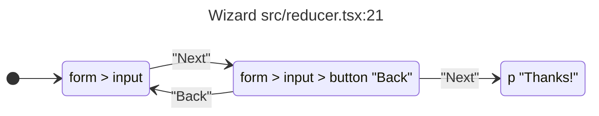

# Architecture

realize reads a React project with the TypeScript 7 checker and builds a model of each component: a small state machine whose states decide what renders. It never runs the code. You can print the model as Mermaid, JSON or a TLA+ module, and check your own invariants against it with [tla-ts](https://www.npmjs.com/package/tla-ts).

The source is the spec here. The model is an over-approximation of what the code can do, so it can't prove the code right. It can show you a path to a state you didn't expect, a branch that never renders, or an assertion the code itself makes that can fail.

## Run

```sh
pnpm analyze tests/fixtures/state-charts/tsconfig.json              # every component
pnpm analyze tests/fixtures/state-charts/tsconfig.json -c Wizard    # one component
pnpm analyze tests/fixtures/state-charts/tsconfig.json -c Wizard --tla
pnpm analyze tests/fixtures/state-charts/tsconfig.json -c Wizard -i 'NoAlert: state_hasError = "false"'
pnpm analyze path/to/app/tsconfig.json -f features/ --json
```

Run these from `packages/realize`.

| Option                       | Effect                                                                       |
| ---------------------------- | ---------------------------------------------------------------------------- |
| `-c, --component <names...>` | Show only these components                                                   |
| `-f, --file <filter>`        | Model only components in files whose path contains this text                 |
| `-d, --depth <n>`            | Cut the render tree off at this depth (default: 12)                          |
| `--json`                     | Print the analyses and models as JSON                                        |
| `--tla`                      | Print each model as a TLA+ module                                            |
| `-i, --invariant <...>`      | Check invariants written as `Name: expression` over the variables and `view` |

By default you get two Mermaid diagrams per component. The first is a `flowchart` of the render tree. It shows every element the component can render, a diamond at each branch with its `✓` and `✗` edges, and a dashed pill for what each handler does to state, like `onClick ⇒ step = "details"`. An expression the analyzer couldn't evaluate is shown as written and marked `⚠`.

The second is a `stateDiagram-v2` of the model's reachable views. Each arrow is labelled with the button text or handler that causes it, and `[*]` points at the views the component can first render. Comments list each variable with its domain and each finding. The counts go to stderr.

## Pipeline

Read `src/core` in this order. Each stage has its own folder, with its helpers next to it.

| Folder or file                               | Stage                                                                          |
| -------------------------------------------- | ------------------------------------------------------------------------------ |
| `project/analyze-project.ts`                 | Opens the TS project, compiles each file, interprets each component, models it |
| `compile/`                                   | Runs the React Compiler on a file and keeps each function's HIR                |
| `type-checker/`                              | Types the HIR from the TS checker and turns types into the values they allow   |
| `interpret/`                                 | Runs the HIR symbolically: the render tree with every branch kept              |
| `handlers/collect-handlers.ts`               | What each event handler and effect updates                                     |
| `model/variables.ts`, `model/domains.ts`     | One variable per tested place, with its domain of abstract values              |
| `model/views.ts`                             | The views a render can show and the predicate of each branch edge              |
| `model/actions.ts`, `model/evaluate.ts`      | Each handler as a guarded action that writes variables                         |
| `model/state-graph.ts`                       | Checks the TLA+ module with tla-ts and reads back the state graph and traces   |
| `model/build-model.ts`                       | Puts the model together and reports findings                                   |
| `model/tla.ts`, `model/check-invariant.ts`   | The TLA+ module and invariant checks through tla-ts                            |
| `render/`, `labels/`                         | Walks render trees, and reads button text to label handlers                    |
| `values/`, `shared/`, `project/serialize.ts` | Symbolic values, printing, JSON output and small shared helpers                |
| `types.ts`, `model/types.ts`                 | The data passed between stages                                                 |

The browser verifier lives in `tests/conformance/verifier`, next to the repos it runs on.

## Interpreting a component

1. Loads the project with `typescript/unstable/sync` (TypeScript 7).
2. Parses each file with Babel and runs the React Compiler on it in `infer` mode, so it finds components by the compiler's own rules: a capitalized function that returns JSX or calls a hook, or one wrapped in `memo` or `forwardRef`.
3. Keeps each component's HIR right after `inferReactivePlaces` and stops the compiler there. A function the compiler can't lower becomes a `compiler-error` bailout. The patch also lowers any default value, like `icon = <Icon />` or `label = theme.closeLabel`, and any `case` test, which the compiler refuses when it can't prove reordering them is unobservable. The analysis doesn't reorder anything. The compiler's check for libraries it won't memoize, like react-hook-form's `watch` or TanStack Table, is turned off, since the analysis doesn't memoize. The compiler's own types for those modules are kept.
4. Types the HIR with the compiler's `inferTypes`, backed by the checker through our patch:
   - React hooks and APIs resolve through the checker, which follows aliases and re-exports to React's declarations.
   - Values the compiler leaves untyped take their TypeScript type: primitives, arrays, `Map`, `Set`, readonly collections and function signatures. A second round lets methods like `items.push` resolve to the compiler's own signatures once `items` is known to be an array.
   - A collection method the compiler doesn't list mutates its receiver when `lib.d.ts` declares it on `Array` but not `ReadonlyArray`, and likewise for `Map` and `Set`.
5. Evaluates the HIR symbolically. Each value becomes an expression over bindings:
   - props, typed from the parameter
   - `useState`, `useReducer` and `useContext`
   - the project's own custom hooks, run inline as part of the component, across files, so their state is the component's state and the functions they return are known
   - zustand stores: every selector of one store reads a field of one value
   - other hooks, typed from their return type
   - `.map` items, including a `.map` reached through an optional chain like `data?.rows.map(…)`, and the rows of `Array.from(arrayLike, callback)`. A binding that stays untyped is an `untyped-item`, `untyped-prop` or similar bailout only when the render, a handler or an assertion reads it. The unused `_` of `[...Array(n)].map((_, index) => …)` is not
   - calls it can't see into whose return type has finite values, like `hasPermission()` returning `boolean`
   - `useRef`: the first render reads the value passed to `useRef`, unless the render itself writes the ref. A handler's write to `ref.current` shows on the next render.
   - module variables the file writes, like `let clicks = 0` with `clicks++` in a handler: the first render reads the declared literal, and any render after a handler may see a new value, since other code can write them too.
   - pure calls on values with a few known cases fold over those cases: `Math.max`, `Math.floor` and the other pure `Math` methods, `Number`, `String`, `parseInt`, `parseFloat`, and `includes` or `indexOf` on a literal list. So does arithmetic on known values. `every`, `some`, `find`, `findIndex` and `filter` over state with a literal initial array run the callback over those items for the first render.
   - values a loop carries, like a flag a `for` body sets, typed as declared. The body runs once with them, so the setters and pushes inside it count, and a value a `break` leaves with is kept.
   - a `push` or property store on a local array or object, applied as is when it always runs. One that may not run, or runs in a loop, widens the value to cover both.
6. Where control flow merges, the value becomes a `Conditional` that records which terminal decided it. Early returns, `?:`, `&&`, `||`, `??`, `?.` and `switch` all produce one. A `?:`, `&&`, `||`, `??` or `?.` merges where it ends, so a `?.` in a `className` doesn't split the rest of the render. Member reads past a `?.`, and reads of a value that may be `undefined`, are assumed not to throw. The compiler lowers every `&&`, `||` and `??` to a branch whose first edge is the left value. For `&&` that edge is taken when the left side is falsy, so the right side of `a && f()` runs under the guard `a`. A test whose value is known decides its branch on the spot: comparisons of two literals, and comparisons of an object, array, function or element with a literal, which `===` never equates and `==` never equates with `null` or `undefined`. So a defaulted option like `{ required = true }` called with `{ required: false }` takes only the branch the caller picked.
7. Turns each binding's type into its possible values. Unions split into cases, and `any` becomes `Unknown`. For plain JS, literal values at call sites stand in for prop types. A type isn't trusted where it can't hold: A module constant, an imported one, or a member of one whose type is a single literal, like `SIZES.small` of an `as const` object or an enum member, reads as that literal, so `case SIZES.small:` compares with `"sm"`.
   - a read through an index signature, like `envKeyMap["azure"]` of a `Record` or `items[0]`, may be `undefined`
   - without `strictNullChecks`, an optional property and a call's result may be `undefined`, which their types leave out
   - a `useState()` with no initial value is typed `undefined`, though a handler may set it to anything
8. Collects handlers from event handlers and effects, and from code that may call the component's functions later:

   - setters and functions passed to child components under any prop name, including render props, function children and components declared inside the component, along with the handlers in the JSX they return, and JSX passed in any prop
   - a function passed as `action` on a `<form>`, or as `formAction` on a `<button>` or `<input>`, which React 19 runs on submit with the form data, and the action a `useActionState` returns, which runs its function like a reducer over the previous state and the form data, with `isPending` typed as a boolean
   - functions passed to hooks and calls it can't see into, directly or in an options object, like `useMutation({ onSuccess })`, and functions stored on objects, like `recognition.onresult`, which run as effects with unknown arguments. When such a call's result is itself passed as an event handler, like `onSubmit={form.handleSubmit(onSubmit)}`, the functions it received run as that element's handler instead
   - ref callbacks, which run when React attaches the element
   - `createPortal(children, container)` renders its children in place

   What each handler does:

   - `setX(...)`, `setX(prev => ...)`, and `dispatch(action)` evaluated through the reducer
   - calls to local and module functions are followed, and a call to a function a condition chooses, like `isDocument ? setDraggedDocument : setDraggedFolder`, may be either
   - a helper that returns JSX, like `getFileIcon(path)`, is followed into whichever file of the project declares it, so its branches become the component's
   - a handler or callback runs with an unknown value for every parameter, since React or the component that calls it decides what it passes. A missing argument is `undefined` only in calls the analyzed code makes itself, so `onChange={(event, checked) => setChecked(checked)}` keeps `checked` open rather than setting the state to `undefined`
   - `catch` blocks run too, as what a handler tries may throw. Each `await` in the `try` body may throw, so the catch runs from each one under its own unknown `throws` guard, and the rest of the body runs under its negation. A failed upload sets its error without reaching the `setStep("done")` after the await. Catch updates are async when the body awaited, since a rejected promise lands there later. A body with no `await` runs the catch once, after the whole body. A `finally` the compiler copies into both paths follows the same order
   - code after `await` or inside `.then` makes the new value `Unknown(async)`
   - a setter a context's providers pair with a field, like `setOpen` with `open` in `value={{ open, setOpen }}`, sets that field when a consumer calls it. It may not happen, since a consumer can render without its provider.
   - a zustand store's action sets the fields its `set` call assigns, from its arguments, literals or the previous state. `useStore.getState().action()` runs the same action, and `useStore.setState(objectOrUpdater)` merges into the state. An action the summary can't model sets the store to unknown. Later updates in the same handler build on earlier ones.
   - a function or setter kept in state, in `ref.current` or in a module variable runs when a handler calls it or passes it as a handler. When several may be stored, exactly one runs.
   - a change event on a controlled checkbox reads `target.checked` as the opposite of `checked`. A radio fires only when unchecked and reads `true`. Both read `target.value` from the `value` attribute. A `select` reads one of its option values.
   - calling into any other hook's result or context value, like `query.fetchNextPage()`, may change it, and every hook from the same module, like `useSelector` after a Redux `dispatch`, to anything, later
   - a built-in array or string method that changes nothing, like `items.find()` or `query.trim()`, leaves the value it's called on as it is, as its type shows
   - state the compiler's effects prove a handler mutates is forgotten, since React shows the new contents on the next render. State it passes to a function that may mutate it, like a library's `remove(items, item)`, is forgotten too, without a warning. When the handler may not re-render, like `items.push(x)` alone or `setItems(items)` with the same array, the mutation stays pending and the next render from any other handler reveals it.

## The model

The interpreter's output is a render tree with every branch kept. The model turns it into a TLA+ specification: variables, an initial state, and actions that change the variables.

### Variables and domains

A variable is one place a branch or handler tests, like `status`, `user.name` or `items.length`. Its domain is a short list of abstract values, split at the literals the code compares the place with.

| Place type      | Domain                                                                |
| --------------- | --------------------------------------------------------------------- |
| A union         | One value per member, like `"idle"`, `"saving"`, or `User` and `null` |
| `boolean`       | `false` and `true`                                                    |
| `string`        | Each compared literal, plus `other string`                            |
| `number`        | Ranges between the compared literals, like `<0`, `0` and `>0`         |
| An object type  | One value named after the type                                        |
| An unknown type | Each compared literal plus `other`, or `truthy` and `falsy`           |

A variable's source says where its value comes from:

| Source    | Value                                                                                         |
| --------- | --------------------------------------------------------------------------------------------- |
| `state`   | `useState` or `useReducer`. It starts at the initial value, and only handlers change it.      |
| `input`   | Props, hooks, context and stores. Any value in its domain, and it may change at any time.     |
| `derived` | A call or memo over other variables. It takes any value again when one of its inputs changes. |
| `opaque`  | A test the model can't split into a place, like `ref.current`. Either `true` or `false`.      |
| `control` | Whether an async handler is still running.                                                    |

### Views and branches

A view is one way the render can look: a choice of edge at each branch, with the predicate that selects it. Its label comes from the elements each edge renders, like `form > button "Back"`. Combinations that contradict themselves, like `role = "admin"` with `role = "viewer"`, are dropped. A component has at most 64 views.

Each branch keeps two edges, its consequent and its alternate, each with the predicate under which it runs. A branch inside another branch's test runs wherever that test runs, so the `?.` in `user?.name && <i />` runs on every render, not only when the `&&` is false. Branches include the ones inside lists, which views leave out.

### Actions

Each handler becomes an action: a guard over the variables and a write to each variable it sets. A write lists the values the variable can take next, and depends only on the variables that change the next value. So `dispatch({ type: "next" })` in the wizard writes `IF state_step = "details" THEN {"payment"} ELSE {"done"}`.

An async handler gets a `control` variable and three actions: the call, then `fulfilled` or `rejected`, with the updates after `await` in the matching action. Each `input` and `opaque` variable with more than one value also gets an action that changes it, since the parent or the outside world can.

### State space and findings

tla-ts, a TypeScript port of TLC, checks the TLA+ module breadth first from every initial state and dumps the state graph, which realize reads back. Each state keeps the step that first reached it, so any reachable state comes with a shortest trace. A state constraint stops the search at 20,000 distinct states or 400,000 generated states, and the model is marked truncated. A model whose `Init` alone has 20,000 states is marked truncated without a check.

A complete model reports three kinds of findings:

| Finding              | When                                                                                   |
| -------------------- | -------------------------------------------------------------------------------------- |
| `unreachable-branch` | No reachable state takes this branch edge, like `state.hasError` when nothing sets it. |
| `stuttering-action`  | A handler never changes the render, or a failed request leaves the render as it was.   |
| `violated-assertion` | An assertion in the code fails in a reachable state.                                   |

A truncated model reports none, since a state past the limit might be the one that answers.

### Assertions

An assertion is something the code states that TypeScript takes on faith: `x!`, `x as T` where `T` leaves out values `x` may hold, and `invariant(cond)` or `assert(cond)`. Each becomes an invariant: its guards imply its test.

An assertion is checked only when it reads `useState` or `useReducer` values alone. An assertion on a prop says the parent never passes that value, which the model can't know. So `user!` behind `status === "ready"` is reported when a handler can set `user` to `null` while `status` stays `"ready"`.

## TLA+ and invariants

`--tla` prints each model as a TLA+ module:

- one variable per model variable, whose values are the labels in its domain
- `view`, the label of the view the variables select
- `Init`, the initial values
- one operator per action, with `Next` as their disjunction, and `Spec`
- one `AssertionN` operator per assertion

`-i 'Name: expression'` checks an invariant on every reachable state with tla-ts, a TypeScript port of TLC. The expression can use the variable names, `view` and the assertion operators. A violation prints the shortest trace:

```text
$ pnpm analyze tests/fixtures/state-charts/tsconfig.json -c Wizard -i 'NeverDone: state_step /= "done"'
Wizard NeverDone: violated
  1. start: state_step=details, state_hasError=false → form > input
  2. "Next": state_step=payment, state_hasError=false → form > input > button "Back"
  3. "Next": state_step=done, state_hasError=false → p "Thanks!"
```

## Conformance

The model over-approximates: every render the component can produce should be one of its reachable states. Conformance checks this against real renders. The verifier mounts each exported component in a browser, explores it, and reports a counterexample when:

- a branch edge the model calls unreachable runs
- a render's branch edges and state values match no reachable state
- an action's handlers can't lead from the state before to the state after in the model
- a state value falls outside the domain of its variable

See [tests/conformance/README.md](../tests/conformance/README.md).

## Warnings

The interpreter also reports warnings from the compiler's mutation effects:

| Warning           | When                                                                                                                   |
| ----------------- | ---------------------------------------------------------------------------------------------------------------------- |
| `lost-update`     | A handler mutates state, then sets it to the same array or object. React skips it.                                     |
| `state-mutation`  | A handler mutates state in place, before copying it or without setting it.                                             |
| `render-mutation` | State is mutated during render.                                                                                        |
| `prop-mutation`   | A prop is mutated, like `items.sort()` on an array prop. A ref prop written through `.current` or a helper is not one. |

A call to a function the project declares counts as a mutation of each argument the function writes into, directly or through a local it loads, stores or destructures the parameter into. `setCardData(items, cardOptions)` where `setCardData` sets `options.shape` mutates the `cardOptions` prop. A call the analysis can't see into, like a library's, is not counted, since the compiler only says it might mutate.

## The React Compiler source

`src/react-compiler` is `babel-plugin-react-compiler`'s source, generated by `pnpm build` and not committed. The build fetches the facebook/react revision that `patches/react-compiler.patch` names and applies the patch, much as react-doctor builds oxc. The patch is the only code of ours in there. It adds a `typeProvider` option that types values from the TypeScript checker, in `Environment.ts` and `InferTypes.ts`, and it lowers three statements the compiler otherwise rejects, in `BuildHIR.ts`: a `finally` clause (run on each way out of its try, unless a `break` or `continue` leaves the try), a `throw` inside a `try` (an edge to its handler), and a dynamic `import()` (an opaque value). It also keeps a non-null assertion `x!` as a `TypeCastExpression` of kind `non-null`, which the compiler otherwise drops, so the analyzer can check it.

- To change the compiler, edit `src/react-compiler` and run `pnpm build --save` to write the patch.
- To move to a newer compiler, run `pnpm build --upgrade <revision>`. It reapplies the patch with a three-way merge and leaves conflict markers where a hunk no longer fits.

## Example

`tests/fixtures/state-charts/src/reducer.tsx`:



The error alert can never show, because nothing dispatches `fail`. The TLA+ module for the same component:

```tla
---- MODULE Wizard ----
\* state_step: state.step (state), 3 values
\* state_hasError: state.hasError (state), 2 values
VARIABLES state_step, state_hasError

vars == <<state_step, state_hasError>>

view == CASE state_step = "done" -> "p \"Thanks!\""
          [] state_step = "details" /\ state_hasError = "true" -> "form > p \"Something went wrong\" > input"
          [] state_step = "payment" /\ state_hasError = "true" -> "form > p \"Something went wrong\" > input > button \"Back\""
          [] state_step = "details" /\ state_hasError = "false" -> "form > input"
          [] state_step = "payment" /\ state_hasError = "false" -> "form > input > button \"Back\""
          [] OTHER -> "nothing"

Init ==
  /\ state_step = "details"
  /\ state_hasError = "false"

\* "Back"
t1 ==
  /\ state_step = "payment"
  /\ state_step' = "details"
  /\ UNCHANGED <<state_hasError>>

\* "Next"
t2 ==
  /\ state_step /= "done"
  /\ state_step' \in (IF state_step = "details" THEN {"payment"} ELSE {"done"})
  /\ state_hasError' = "false"

Next == t1 \/ t2

Spec == Init /\ [][Next]_vars
====
```

## Known gaps

- **Domains only split at compared literals.** Two values the code never tells apart share an abstract value, so the model can't see a difference that only shows in what renders.
- **Inputs change freely.** Props, hooks, context and stores take any value in their domain at any time. A path through a value the parent never passes is still reachable.
- **Derived values lose their link.** A call or memo takes any value in its domain when an input changes, not only the one it computes.
- **Library calls are opaque.** Their code isn't in the project, so a call's result is known only from its return type.
- **Loops run once.** A value a loop carries can take any value its type allows after the loop.
- **One model per component.** Parents and children aren't linked, so a child's props come from their types.
- **Class components are reported, not analyzed.** The React Compiler lowers only function components and hooks, so each class gets a `class-component` bailout.
